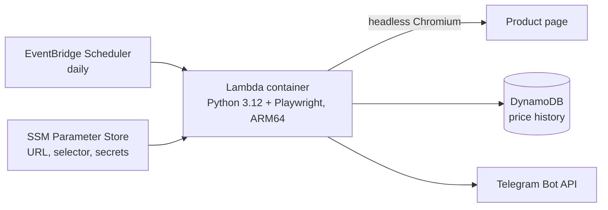

# simple-deterministic-price-tracker

**A daily price watcher that runs on the AWS free tier.** A Lambda container opens the product page in headless Chromium, reads the price with a CSS selector, stores the history in DynamoDB and sends the current and previous price to Telegram. Deterministic on purpose: a selector, not an LLM, reads the price.



**Cost:** about $0–0.20 per month. **Infra:** Terraform, image in ECR, deploy by script or GitHub Actions.

**Stack:** Python 3.12 · Playwright · AWS Lambda (container, Graviton) · DynamoDB · EventBridge Scheduler · SSM · ECR · Terraform · GitHub Actions

## Architecture

- **Lambda Function**: Python 3.12 container image with Playwright (ARM64/Graviton2)
- **Database**: DynamoDB (on-demand, always-free 25GB)
- **Scheduling**: EventBridge Scheduler (daily trigger)
- **Configuration**: SSM Parameter Store (free)
- **Notifications**: Telegram Bot API
- **Infrastructure**: Terraform
- **Container Registry**: Amazon ECR

## Cost

**~$0-$0.20/month** (essentially free with AWS free tier)
- Lambda ARM64/Graviton2 is 20% cheaper than x86_64
- DynamoDB on-demand with 25GB always-free storage
- EventBridge Scheduler free for up to 14M invocations/month

## Prerequisites

- AWS Account
- AWS CLI configured
- Docker installed
- Terraform installed
- Python 3.12
- Telegram account

## Quick Start

### 1. Create Telegram Bot

1. Open Telegram and search for `@BotFather`
2. Send `/newbot` and follow the prompts to create your bot
3. Copy the bot token (format: `1234567890:ABCdefGHIjklMNOpqrsTUVwxyz`)
4. Start a chat with your bot and send any message
5. Get your chat ID by visiting: `https://api.telegram.org/bot<YOUR_BOT_TOKEN>/getUpdates`
6. Look for `"chat":{"id":YOUR_CHAT_ID}` in the response

### 2. Find the CSS Selector for Your Product Price

1. Open the product page in your browser
2. Right-click on the price element and select "Inspect"
3. In the DevTools, right-click on the highlighted element
4. Look for unique attributes like `data-testid`, `data-ui-name`, or specific class names
5. Avoid using complex `nth-child()` selectors - they break easily
6. Test your selector in browser console: `document.querySelector("YOUR_SELECTOR")`

**Example**: For a price element with `<span data-ui-name="ads.price.strong">151,03</span>`, use `[data-ui-name="ads.price.strong"]`

### 3. Configure and Deploy

```bash
cd price_tracker

# Create terraform variables
cp terraform/terraform.tfvars.example terraform/terraform.tfvars
# Edit terraform/terraform.tfvars with your values:
#   - product_url: Your product page URL
#   - price_selector: CSS selector from step 2
#   - telegram_bot_token: From step 1
#   - telegram_chat_id: From step 1

# Deploy everything (builds Docker image, creates ECR, deploys Lambda)
./deploy.sh
```

The `deploy.sh` script handles:
- Building the Docker image
- Creating/cleaning up ECR repository
- Pushing the image to ECR
- Deploying all infrastructure with Terraform

### 3a. Alternative: Deploy with GitHub Actions (Recommended)

For automatic deployment when you push to the `main` branch:

1. **Configure GitHub Secrets and Variables** - Go to your repository → Settings → Secrets and variables → Actions:

   **Secrets** (encrypted):
   - `AWS_ACCESS_KEY_ID` - Your AWS access key
   - `AWS_SECRET_ACCESS_KEY` - Your AWS secret key
   - `TELEGRAM_BOT_TOKEN` - From step 1 above
   - `TELEGRAM_CHAT_ID` - From step 1 above

   **Variables** (not sensitive):
   - `PRODUCT_URL` - Your product page URL
   - `PRICE_SELECTOR` - CSS selector from step 2

2. **Push to main branch** - The workflow will automatically:
   - Build the Docker image
   - Push to ECR
   - Deploy Lambda function and infrastructure
   - You can monitor progress in the Actions tab

**Benefits of GitHub Actions deployment:**
- Automatic deployment on every push to main
- No need for local Docker/Terraform installation
- Consistent deployment environment
- Deployment history and logs in GitHub

### 4. Test

```bash
# Invoke Lambda manually
aws lambda invoke \
  --function-name price-tracker \
  --region eu-west-3 \
  output.json

# View the result
cat output.json

# Check logs
aws logs tail /aws/lambda/price-tracker --region eu-west-3 --follow
```

Expected output:
```json
{
  "statusCode": 200,
  "body": "{\"success\": true, \"price\": 151.03, \"timestamp\": \"2025-12-18T21:31:05.400324\", \"previous_price\": null, \"notification_sent\": true}"
}
```

## Configuration

### Product Tracking

Update these in `terraform/terraform.tfvars`:

- `product_url`: URL of the product page
- `price_selector`: CSS selector for the price element (use attribute selectors for reliability)

Example:
```hcl
product_url = "https://www.obi.pl/panele-podlogowe/classen-panel-podlogowy-dab-diamante-8-mm-ac-5/p/6833438"
price_selector = "[data-ui-name=\"ads.price.strong\"]"  # Robust selector using data attribute
```

**Tip**: Attribute selectors like `[data-ui-name="..."]` are more reliable than class-based or `nth-child()` selectors.

### Schedule

Default: Daily at 10:00 UTC

Change in `terraform/scheduler.tf`:
```hcl
schedule_expression = "cron(0 17 * * ? *)"
```

## Monitoring

### CloudWatch Logs

```bash
aws logs tail /aws/lambda/price-tracker --follow
```

### DynamoDB Table

View price history in AWS Console: DynamoDB → Tables → price-history

### Lambda Metrics

AWS Console: Lambda → Functions → price-tracker → Monitoring

## Troubleshooting

### Lambda fails with "Runtime.InvalidEntrypoint"

This was fixed by:
- Using absolute imports instead of relative imports (`from src.module import` vs `from .module import`)
- Ensuring Lambda architecture matches Docker image architecture (ARM64)
- Setting correct file permissions with `chmod 644` in Dockerfile

### Playwright browser not found

Fixed by setting `PLAYWRIGHT_BROWSERS_PATH=/opt/playwright` environment variable in both Dockerfile and Lambda configuration.

### Browser crashes in Lambda

Fixed by adding Lambda-compatible Chromium launch arguments:
```python
browser = p.chromium.launch(
    headless=True,
    args=[
        '--no-sandbox',
        '--disable-setuid-sandbox',
        '--disable-dev-shm-usage',
        '--single-process',
    ]
)
```

### Price selector timeout (element not visible)

Fixed by:
1. Using `state='attached'` instead of default `state='visible'` in `wait_for_selector`
2. Finding the first visible element when multiple elements match
3. Using attribute selectors like `[data-ui-name="..."]` instead of complex `nth-child()` selectors

### Price selector not working

1. Open the product URL in a browser
2. Inspect the price element and look for unique attributes (`data-*`, `id`, unique classes)
3. Test the selector in browser console: `document.querySelector("YOUR_SELECTOR")`
4. Update `price_selector` in `terraform/terraform.tfvars`
5. Run `cd terraform && terraform apply` to update Lambda

### No Telegram notifications

1. Verify bot token: `curl https://api.telegram.org/bot<TOKEN>/getMe`
2. Verify chat ID: Send a message to your bot, then run `curl https://api.telegram.org/bot<TOKEN>/getUpdates`
3. Check Lambda logs: `aws logs tail /aws/lambda/price-tracker --region eu-west-3 --follow`

## Development

### Local Testing

```bash
# Install dependencies
pip install -r requirements.txt
playwright install chromium

# Test with mocked AWS
pip install moto
python -c "from src.lambda_handler import lambda_handler; lambda_handler({}, None)"
```

### Docker Testing

```bash
docker build -t price-tracker .

# Test with Lambda RIE
docker run -p 9000:8080 \
  -e PRODUCT_URL="https://example.com" \
  -e PRICE_SELECTOR=".price" \
  price-tracker

curl -X POST "http://localhost:9000/2015-03-31/functions/function/invocations" -d '{}'
```

## Free Tier Limits

- Lambda: 1M requests/month, 400K GB-seconds
- EventBridge: 14M invocations/month
- DynamoDB: 25GB storage, 25 RCU/WCU
- CloudWatch: 5GB logs
- ECR: 500MB storage

Daily price check uses:
- ~30 Lambda requests/month
- ~300 GB-seconds compute
- <1MB DynamoDB storage/day
- ~20MB logs/month

All well within free tier!

## License

[MIT](LICENSE)

---

Built by [Wiaczeslaw Cyunczyk](https://tslava.dev)
